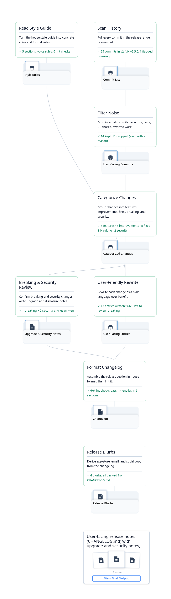

# Examples

**English** · [简体中文](EXAMPLES.zh-CN.md)

A gallery of example traces — each built from a popular open-source agent skill. Find one by domain:

| Domain | Example |
|---|---|
| 📄 Career | Tailored Résumé Generator |
| 💰 Investing | Comprehensive Stock Analysis |
| 🤝 Corp dev / M&A | SaaS Acquisition Due Diligence |
| 🛡 Security / DevSecOps | Security CI/CD Pipeline |
| ✍️ Research / writing | Industry Deep-Dive Report |
| 🐛 Software engineering | Bug-Fix Learning Loop |
| 📈 Growth / marketing | Weekly Paid-Ads Optimization |
| 🧠 Knowledge / personas | Distill a Mind into a Skill |
| 🖼 Design / decks | Talk → Magazine Slide Deck |
| 📝 Product / releases | Changelog from Commits |

**Run one** — ▶ *live* (the real use): tell your agent _"run this trace"_ on your own input, and it does each
node's work for real. ▷ *demo*: `bash scripts/examples/<id>/build.sh` replays a pre-recorded, illustrative
run; `flowtrace serve` opens the UI. Synthetic CLI-surface / animation demos live in
[REFERENCE-TRACES.md](trace/REFERENCE-TRACES.md).

---

## 📄 Career — Tailored Résumé Generator

Tailor a résumé to a job posting — parse the posting and résumé in parallel, score every bullet, rewrite the weak ones, format ATS-safe. Each judgment is a node you can point at and overrule. *Demo: a fictional candidate.*

**Source** [ComposioHQ/awesome-claude-skills](https://github.com/ComposioHQ/awesome-claude-skills) · **Demo** `bash scripts/examples/tailored-resume/build.sh`

---

## 💰 Investing — Comprehensive Stock Analysis

A comprehensive single-stock analysis — four data lanes (price, fundamentals, macro, news) → five analyses → a synthesized buy / hold / sell thesis → position sizing. Change one assumption and the whole chain re-evaluates. *Demo: NVDA.*

**Source** [tradermonty/claude-trading-skills](https://github.com/tradermonty/claude-trading-skills) · **Demo** `bash scripts/examples/nvda-decision/build.sh`

---

## 🤝 Corp dev / M&A — SaaS Acquisition Due Diligence

Acquisition due diligence as a DAG — four ingest streams → five C-suite lenses in parallel (run serially, the first lens's framing contaminates the rest) → a two-sided thesis → valuation → a last-but-binding compliance veto. *Demo: a fictional company, illustrative figures.*

**Source** [alirezarezvani/claude-skills](https://github.com/alirezarezvani/claude-skills) · **Demo** `bash scripts/examples/saas-dd/build.sh`

---

## 🛡 Security / DevSecOps — Security CI/CD Pipeline

A PR security gate — six parallel scans → triage → red-team (ATT&CK) ∥ blue-team (Sigma/YARA) → a gate that blocks only on findings both high-severity and confirmed exploitable. Red-team runs *after* triage, not before: validating un-deduped findings burns cycles on false positives.

**Source** [mukul975/Anthropic-Cybersecurity-Skills](https://github.com/mukul975/Anthropic-Cybersecurity-Skills) · **Demo** `bash scripts/examples/security-cicd/build.sh`

---

## ✍️ Research / writing — Industry Deep-Dive Report

Write a long-form industry report — the first node fixes audience, goal, and angle, and the ten nodes after depend on it. Edit that one judgment (say, VC investors → enterprise founders) and the outline, draft, and sections rewrite downstream.

**Source** [ComposioHQ/awesome-claude-skills](https://github.com/ComposioHQ/awesome-claude-skills) (`content-research-writer`) · **Demo** `bash scripts/examples/research-writer/build.sh`

---

## 🐛 Software engineering — Bug-Fix Learning Loop

A bug-fix loop — systematic-debugging's four phases → a TDD fix → two-stage review. Each run writes back the codebase-specific gotcha it found and sharpens its own STEP.md, so by the fifth run the trace knows your code — the diff visible in git log.

**Source** [obra/superpowers](https://github.com/obra/superpowers) · **Demo** `bash scripts/examples/swe-bugfix/build.sh`

---

## 📈 Growth / marketing — Weekly Paid-Ads Optimization

A weekly paid-ads loop — each week's data fans into five diagnoses → a problem tree → test candidates drawn from accumulated `memory.md`. The hypothesis node starts generic and, twenty weeks in, writes brand-specific heuristics earned from real experiments — the trace becomes your playbook.

**Source** [coreyhaines31/marketingskills](https://github.com/coreyhaines31/marketingskills) · **Demo** `bash scripts/examples/paid-ads/build.sh`

---

## 🧠 Knowledge / personas — Distill a Mind into a Skill

Distill a person's thinking into a reusable skill — six parallel research lanes, but only traits surviving a triple test (cross-domain ∧ predictive ∧ distinctive) reach the synthesis. Every lane cites a file, so the persona can't claim a trait that isn't on disk. *Demo: a fictional figure.*

**Source** [alchaincyf/nuwa-skill](https://github.com/alchaincyf/nuwa-skill) (花叔 / 女娲) · **Demo** `bash scripts/examples/distill-mind/build.sh`

---

## 🖼 Design / decks — Talk → Magazine Slide Deck

Turn raw content into a single-file HTML magazine deck — pick a visual system, build a rhythm table, select layouts while image prompts generate in parallel, assemble, self-validate. Picked Swiss for a talk that wanted editorial? Switch `choose_style` and the whole deck re-renders.

**Source** [op7418/guizang-ppt-skill](https://github.com/op7418/guizang-ppt-skill) (歸藏) · **Demo** `bash scripts/examples/talk-to-deck/build.sh`

---

## 📝 Product / releases — Changelog from Commits

Turn a release's git log into notes your users will actually read. The history and the house style guide are read in parallel, and noise is filtered *before* categorizing: a feature and its revert cancel out, but a dependency bump that patches an advisory is not noise. Breaking changes and security fixes get their own review lane, because they owe readers upgrade steps and careful disclosure wording; that is the node that waits for a maintainer. *Demo: a fictional app's v2.5.0, 25 commits → 14 entries.*

**Source** [ComposioHQ/awesome-claude-skills](https://github.com/ComposioHQ/awesome-claude-skills) (`changelog-generator`) · **Demo** `bash scripts/examples/changelog-from-commits/build.sh`

---

## Source attribution

The open-source skills these traces are built from:

| Example | Source | License |
|---|---|---|
| Tailored Résumé Generator | [ComposioHQ/awesome-claude-skills](https://github.com/ComposioHQ/awesome-claude-skills) | Apache 2.0 |
| Comprehensive Stock Analysis | [tradermonty/claude-trading-skills](https://github.com/tradermonty/claude-trading-skills) | MIT |
| SaaS Acquisition Due Diligence | [alirezarezvani/claude-skills](https://github.com/alirezarezvani/claude-skills) | MIT |
| Security CI/CD Pipeline | [mukul975/Anthropic-Cybersecurity-Skills](https://github.com/mukul975/Anthropic-Cybersecurity-Skills) | Apache 2.0 |
| Industry Deep-Dive Report | [ComposioHQ/awesome-claude-skills](https://github.com/ComposioHQ/awesome-claude-skills) (`content-research-writer`) | Apache 2.0 |
| Bug-Fix Learning Loop | [obra/superpowers](https://github.com/obra/superpowers) | MIT |
| Weekly Paid-Ads Optimization | [coreyhaines31/marketingskills](https://github.com/coreyhaines31/marketingskills) | MIT |
| Distill a Mind into a Skill | [alchaincyf/nuwa-skill](https://github.com/alchaincyf/nuwa-skill) (花叔 / 女娲) | MIT |
| Talk → Magazine Slide Deck | [op7418/guizang-ppt-skill](https://github.com/op7418/guizang-ppt-skill) (歸藏) | AGPL-3.0 ¹ |
| Changelog from Commits | [ComposioHQ/awesome-claude-skills](https://github.com/ComposioHQ/awesome-claude-skills) (`changelog-generator`) | Apache 2.0 |

¹ `talk-to-deck` builds on an AGPL-3.0 source — workflow only (our own renderer, no source files copied).

---

## How to write your own

Every example above is a real builder you can read end to end: `scripts/examples/<id>/template/` holds the
`trace.json` (the DAG), per-step `STEP.md` contracts, and shared `scripts/` — the same anatomy you'd author by
hand. The move that makes each one is to read a source skill's prose, pull out the steps hiding in
it, and work out how they connect — which run in parallel, which fan in. The arrows are the knowledge, so get
them right.

To turn your own source into a trace — a `SKILL.md`, a runbook, a chat log, a finished task — use the
[`make-trace`](../skills/make-trace/SKILL.md) skill: copy `skills/make-trace/` into your agent's skills directory
and run `/make-trace`. For the trace.json schema see [SCHEMA.md](trace/SCHEMA.md); for the agent-facing CLI
reference see [CLI.md](trace/CLI.md).
